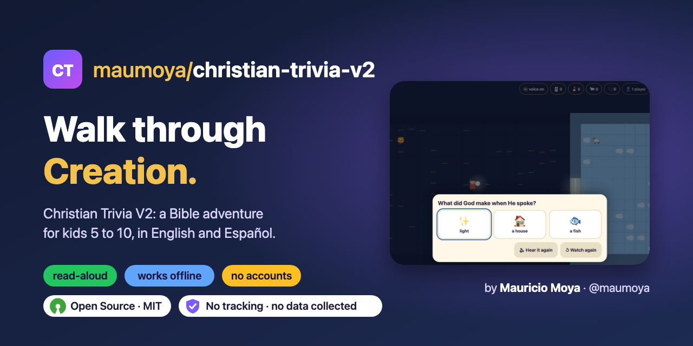
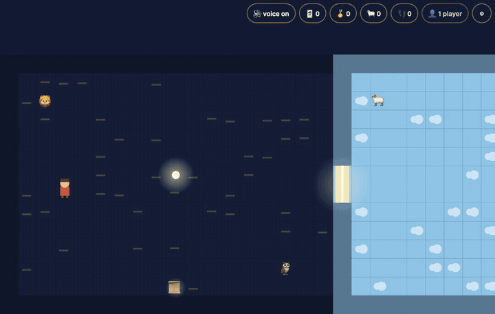
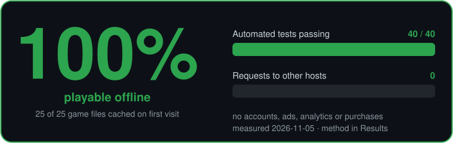

<p align="center"><a href="https://maumoya.github.io/christian-trivia-v2/"></a></p>

<p align="center">
  <a href="https://maumoya.github.io/christian-trivia-v2/"></a>
</p>

<p align="center">
  <a href="LICENSE"></a>
  <a href="https://opensource.org/license/mit"></a>
  
  <a href="https://github.com/maumoya/christian-trivia-v2/releases"></a>
  <a href="https://github.com/maumoya/christian-trivia-v2/actions/workflows/test.yml"></a>
  <a href="https://github.com/maumoya/christian-trivia-v2/actions/workflows/codeql.yml"></a>
  <a href="https://scorecard.dev/viewer/?uri=github.com/maumoya/christian-trivia-v2"></a>
  <!--bestpractices-badge-->
</p>

<p align="center">
  <a href="https://maumoya.github.io/christian-trivia-v2/"></a>
</p>

<p align="center">
  <a href="#results-measured-2026-11-05"></a>
</p>

# Christian Trivia V2: Creation

**Walk through the seven days of Creation, answer, collect, explore.** A Bible adventure for kids aged 5 to 10.

**Play:** https://maumoya.github.io/christian-trivia-v2/ (works offline after the first visit; add it to your home screen)

V2 of [Christian Trivia](https://github.com/maumoya/christian-trivia) ([play V1](https://maumoya.github.io/christian-trivia/)).
V1 was a one-day MVP: tap through scenes, one question each. V2 turns it into a world: the child walks a character
through Genesis 1 and 2, finds the glowing spots, and each answer opens the gate to the next day.

## What's inside

- An overworld for Chapter 1, Creation: 8 scenes, quests, 12 story items, 5 verse pieces, badges and a companion.
- One question per scene, with a hint and "hear it again". Right answers earn timeline cards.
- English and Español, with read-aloud for kids who don't read yet. Verses: WEB and KJV (English), RVR1909 (Spanish).
- God is shown as light and a voice, never a face.
- Two players on one keyboard or screen.
- A grown-ups area behind an adult check: minutes per day, quiet hours, chapters per session.
- Offline PWA. Plain JavaScript modules, no engine, no build step, no dependencies, no accounts, no tracking.

## Run it locally

```bash
git clone https://github.com/maumoya/christian-trivia-v2.git && cd christian-trivia-v2
npm start   # then open http://localhost:8642/
npm test    # 40 tests, Node 20 or newer, no install step
```

Controls: arrow keys (player 1) and WASD (player 2), or touch and drag. Tap a spot to walk there.

## Results (measured 2026-11-05)

| Check | Result | Method |
|---|---|---|
| Automated tests | **40 / 40 pass** | `node --test` (also in CI on every PR) |
| Works offline | **25 / 25 files cached** | `tests/guards.test.js` checks every shipped file is in the service worker list |
| Requests to other hosts | **0** | `tests/guards.test.js` scans every shipped file for another host |

## FAQ

**Does it collect data?** No. No accounts, ads, analytics or purchases. Progress stays in the browser (see [SECURITY.md](SECURITY.md)).

**Which Bible text?** Public-domain WEB, KJV and RVR1909 from eBible.org; the source is recorded in each file.

**How is it different from V1?** V1 is a one-page trivia game. V2 is an adventure you walk through, with quests,
two players and offline play. V1 stays live and unchanged.

## Licence

MIT © 2026 Mauricio Alonso Moya Tapia. Bible texts are public domain.
